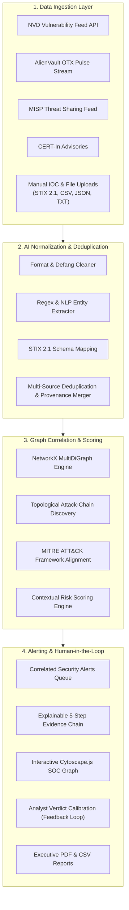

# AI-Powered Cyber Threat Intelligence (CTI) Correlation Platform

**Tagline:** *Smarter Intelligence. Safer Tomorrow.*  
**Theme:** Cybersecurity | **Category:** Software | **Team Name:** TRIPLE HACK

---

## 1. Project Introduction

In modern enterprise security operations centers (SOCs), cyber threat intelligence is scattered across isolated tools, proprietary feeds, and public OSINT streams. Security analysts are overwhelmed by alert fatigue, duplicate notifications, and siloed indicators that lack meaningful context.

The **AI-Powered Cyber Threat Intelligence Correlation Platform** addresses this challenge by providing an end-to-end autonomous pipeline that:
- **Collects** threat telemetry across multiple intelligence sources (AlienVault OTX, MISP, CERT-In, NVD).
- **Normalizes and deduplicates** indicators into a unified STIX 2.1-inspired canonical schema without loss of source attribution.
- **Extracts** structured observables, threat actors, malware families, and ATT&CK IDs from unstructured text using AI/NLP.
- **Correlates** related indicators using graph analytics (NetworkX MultiDiGraph / Cytoscape.js) to reconstruct multi-hop attack chains.
- **Evaluates** explainable, multi-factor contextual risk scores (0–100).
- **Generates prioritized alerts** backed by complete, verifiable 5-stage evidence chains.

---

## 2. Core USP (Unique Selling Proposition)

> **Explainable attack-chain correlation instead of isolated security alerts.**

Traditional security platforms alert on single, disconnected indicators (e.g., "Suspicious IP 185.220.101.5 detected"). Our platform reconstructs the whole picture:
1. Which initial vulnerability was probed (e.g. Citrix Bleed CVE-2023-4966).
2. Which phishing domain was employed (e.g. `update-microsoft-auth.com`).
3. Which C2 team server infrastructure was resolved.
4. Which in-memory payload was executed (e.g. Cobalt Strike beacon hash `e3b0c44...`).
5. Which adversary group orchestrated the attack (e.g. APT29 / Midnight Blizzard).
6. Exactly why the contextual risk score was calculated, including supporting mathematical factors.

---

## 3. System Architecture



---

## 4. Technology Stack

- **Frontend:** React 18, TypeScript, Vite, Tailwind CSS, Cytoscape.js (for graph visualization), Recharts, Lucide React, Axios.
- **Backend:** Python 3.11+, FastAPI, Pydantic v2, SQLAlchemy, NetworkX (Graph Analytics), PBKDF2/JWT Security, python-multipart.
- **AI & NLP:** Regex multi-pattern tokenizers, rule-based NER, spaCy integration fallback, defanging algorithms.
- **Data & Standards:** OASIS STIX 2.1, MITRE ATT&CK Enterprise Matrix, NIST NVD CVSS v3.1, SQLite / PostgreSQL.
- **DevOps:** Docker, Docker Compose, Windows Batch / PowerShell launch scripts.

---

## 5. Folder Structure

```
ai-powered-cti/
├── backend/
│   ├── app/
│   │   ├── api/            # REST API routers (auth, dashboard, intelligence, graph, alerts, etc.)
│   │   ├── core/           # Security, JWT tokens, Pydantic settings
│   │   ├── models/         # SQLAlchemy ORM models
│   │   ├── schemas/        # Pydantic request/response schemas
│   │   ├── ai/             # NLP entity extractor & defanging helpers
│   │   ├── graph/          # NetworkX graph correlation engine
│   │   ├── ingestion/      # STIX 2.1 normalizer & deduplication engine
│   │   ├── risk/           # Contextual explainable risk scoring
│   │   ├── services/       # Demo pipeline, alert generation, reports
│   │   └── database/       # DB session and SQLite/PostgreSQL engine
│   ├── tests/              # 14 automated unit tests
│   └── requirements.txt
├── frontend/
│   ├── src/
│   │   ├── components/     # Header, Sidebar, DemoPipelineModal
│   │   ├── pages/          # 11 SOC platform pages
│   │   ├── context/        # Auth state management
│   │   └── services/       # Axios API client
│   └── package.json
├── data/
│   ├── demo/               # Operation Arctic Eclipse synthetic dataset
│   ├── mitre/              # MITRE ATT&CK technique catalog
│   └── samples/            # Sample CSV, STIX 2.1 JSON, and TXT reports
├── docker/                 # Backend and Frontend Dockerfiles
├── docs/                   # ARCHITECTURE, API, SCHEMA, DEMO_GUIDE
├── scripts/                # Launch scripts for Windows & Linux
├── docker-compose.yml
└── README.md
```

---

## 6. Installation and Setup Instructions

### Prerequisites
- **Python**: Version 3.10+ (Tested on Python 3.14 / 3.11)
- **Node.js**: Version 18+ (Tested on Node.js v24 / v20)
- **Git**

### Fast Local Execution (Windows)

1. **One-Click Launch:**
   Double-click:
   ```cmd
   scripts\run_all.bat
   ```
   This will start both backend (port 8000) and frontend (port 5173) in separate command windows.

2. **Or Manual Terminal Startup:**

   **Terminal 1 — Backend:**
   ```bash
   python -m pip install -r backend/requirements.txt
   $env:PYTHONPATH = "backend"
   python -m uvicorn app.main:app --host 127.0.0.1 --port 8000 --reload
   ```

   **Terminal 2 — Frontend:**
   ```bash
   cd frontend
   npm install
   npm run dev
   ```

3. **Open the Application:**
   - **SOC Dashboard:** `http://localhost:5173`
   - **Interactive API Swagger:** `http://localhost:8000/docs`

---

## 7. Demo Login Credentials


| Role | Email | Password | Permissions |
|---|---|---|---|
| **Admin** | `admin@cti.platform` | `Admin123!` | Full platform access, risk weight calibration, user management |
| **Analyst** | `analyst@cti.platform` | `Analyst123!` | Threat triage, graph exploration, feedback verdicts |
| **Viewer** | `viewer@cti.platform` | `Viewer123!` | Read-only dashboards and report export |

---

## 8. How to Run the 1-Click Correlation Demo

1. Log in with **Admin** credentials.
2. In the top navigation bar, click the glowing button: **RUN THREAT CORRELATION DEMO**.
3. A live animated progress modal will trace through all 8 pipeline stages:
   - Ingesting feeds from AlienVault OTX, MISP, CERT-In, and NVD.
   - Extracting threat indicators using AI/NLP.
   - Normalizing to STIX 2.1 schema.
   - Merging duplicate indicators and preserving multi-source provenance.
   - Constructing the NetworkX attack graph.
   - Aligning with MITRE ATT&CK techniques.
   - Calculating contextual risk scores.
   - Generating explainable alerts.
4. Click **Explore Results** to inspect the interactive attack graph and evidence chains.

---

## 9. Automated Test Execution

Run the backend pytest suite verifying authentication, NLP extraction, STIX normalization, deduplication, graph construction, and alert generation:

```bash
$env:PYTHONPATH = "backend"
python -m pytest backend/tests -v
```

**Result:** 14 passed out of 14 unit tests (100% pass rate).

---

## 10. Limitations & Future Scope

- **Neo4j / OpenSearch Production Scale:** The prototype runs with high-performance SQLite and NetworkX in-memory graphs for zero-setup execution on any developer laptop. A modular connector allows direct connection to Neo4j and OpenSearch in large-scale deployments.
- **Automated SIEM Push:** Future versions can push verified attack chains directly into Splunk, Microsoft Sentinel, and Elastic SIEM via automated Webhooks and TAXII 2.1 channels.
- **Defense-Only Notice:** This system is engineered strictly for defensive cybersecurity triage and threat intelligence correlation. It does not perform offensive scanning or automated endpoint execution.


