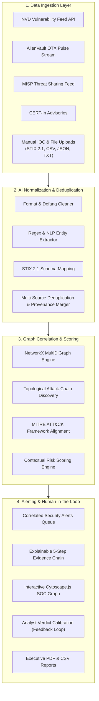

# System Architecture

## AI-Powered Cyber Threat Intelligence Correlation Platform
**Tagline:** *Smarter Intelligence. Safer Tomorrow.*

---

## 1. High-Level Architecture Overview

The platform implements an autonomous, four-stage cybersecurity intelligence pipeline designed to ingest noisy, isolated threat data from disparate external sources, convert them into a standardized STIX 2.1 schema, extract entities via AI/NLP, correlate indicators into topological multi-hop attack graphs, compute explainable risk scores, and deliver prioritized alerts backed by verifiable evidence chains.

---

## 2. Pipeline Stage Details

### Stage 1: Collect (Multi-Source Ingestion)
- **Connectors**: Supports REST APIs, STIX 2.1 JSON bundles, CSV feeds, and raw TXT incident advisories.
- **Fail-Safe Operation**: Employs built-in synthetic datasets (`data/demo/synthetic_scenario.json`) so the entire platform operates offline on a developer workstation without requiring external API keys.

### Stage 2: Normalize (Unified STIX 2.1 Schema & Deduplication)
- **Canonical Schema**: Maps disparate fields into a uniform model: `type`, `value`, `threat_category`, `confidence`, `severity`, `first_seen`, `last_seen`, `sources`, `tags`, `cve_references`, and `mitre_techniques`.
- **Intelligent Deduplication**: When an indicator (e.g. `185.220.101.5` or `update-microsoft-auth.com`) appears across multiple sources (OTX, MISP, CERT-In), the engine preserves provenance, increments attribution frequency, elevates confidence, and retains raw history rather than discarding data.

### Stage 3: Correlate (Graph Analytics & Risk Scoring)
- **Graph Nodes**: Indicators (IP, Domain, URL, Hash), Vulnerabilities (CVE), Malware Families, Threat Actors, ATT&CK Techniques.
- **Graph Edges**: `RESOLVES_TO`, `HOSTS`, `INDICATES`, `ASSOCIATED_WITH`, `EXPLOITS`, `USES_TECHNIQUE`, `ATTRIBUTED_TO`.
- **Topological Traversal**: Identifies weakly connected multi-stage subgraphs linking perimeter reconnaissance through C2 to data impact.
- **Explainable Risk Scoring**:
  $$\text{Risk Score} = (S \times 0.30) + (C \times 0.25) + (R \times 0.15) + (V \times 0.15) + (G \times 0.15)$$
  *Where $S=$ Severity, $C=$ Confidence, $R=$ Source Reliability, $V=$ Vuln Impact, $G=$ Correlation Strength.*

### Stage 4: Alert & Respond (Evidence Chains & SOC UX)
- **Explainable Evidence Chain**: Alerts do not display isolated counters. Instead, each alert details:
  1. Initial external exploitation attempt
  2. Phishing and credential compromise
  3. C2 domain and IP infrastructure resolution
  4. In-memory execution and tool hash signatures
  5. Target exfiltration or ransomware staging
- **Feedback Calibration**: Analysts can submit *True Positive*, *False Positive*, or *Investigating* classifications, interactively tuning mathematical weights.

